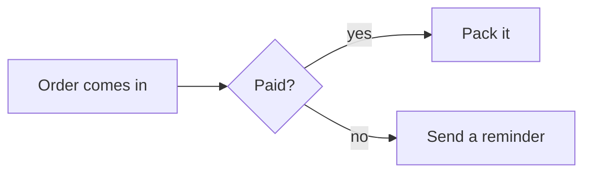
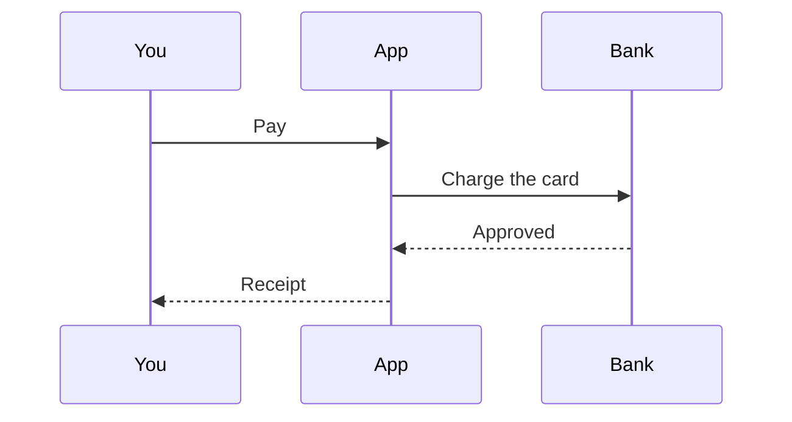
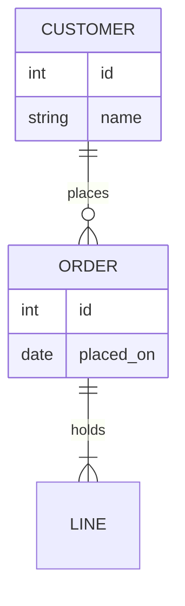

# Mermaid diagrams

**/mermaid** draws a diagram from a few lines of text: a flowchart, a sequence of messages, a data model, a timeline, a pie, and twenty more kinds. Change the words and the diagram follows; nothing has to be lined up by hand.

## A flowchart

```markdown
flowchart LR
A[Order comes in] --> B{Paid?}
B -- yes --> C[Pack it]
B -- no --> D[Send a reminder]
```



**Edit**, on the diagram's bar, shows its text to change; **Copy** copies it. `LR` runs it left to right; `TD` runs it top down. `[ ]` is a box, `{ }` a decision, `( )` a rounded box, and `-- words -->` puts words on a line.

## Who says what, in order



## A data model

An `erDiagram` draws tables and how they join:



Its bar has **SQL**, to turn the diagram into SQL: choose PostgreSQL, MySQL or SQLite, then put the `CREATE TABLE` script under the diagram or copy it. Foreign keys come from the lines between the tables. Do it again after changing the diagram, and the script it made is written over, so the diagram stays the one to change.

## Save it as a picture

**Expand** opens a diagram full size, and **Save as a picture** there saves it: a PNG for slides and chats, or an SVG that stays sharp at any size. Download it, or keep it in the Drive.

:::callout 💡
For a diagram you would rather arrange by hand, use a board. For signals over time, a note has **/timing**; for circuits, **/circuit**.
:::
